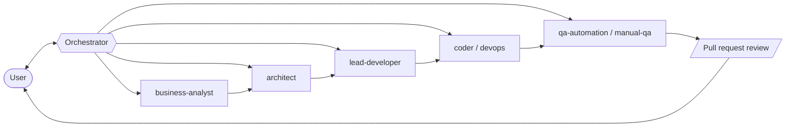

# fast-sdlc
Agentic Framework for software development

## Overview

Fast SDLC is a Claude Code plugin that turns a session into an orchestrator coordinating specialized AI agents. It can take any scope, from business requirements to tested code, through a defined software development lifecycle: each stage is handled by an agent with a single, well-defined role.

It is built for developers who want to delegate a whole delivery pipeline to AI agents while keeping control over what gets merged.

## Key Features

- **Orchestrator–subagent architecture**: one orchestrator session plans and tracks the work, and spawns a specialized subagent for each task.
- **End-to-end SDLC pipeline**: business analysis, architecture, repo-level planning, implementation, QA, and documentation reconcile.
- **Multiple workflows**: project initiation, new work planning, story execution, issue reporting, and research.
- **Multi-repository support**: architecture is designed across repos, and each repo (and stack) gets its own implementation plan and tasks.
- **Human-in-the-loop review**: the user reviews the plan, the pull requests, and the final acceptance before a story is considered done.

## How It Works



The user talks only to the orchestrator. For each story it creates tasks and spawns the responsible subagent: requirements first, then architecture, then a per-repo implementation plan, then the code, then QA. A task can run autonomously, or, for work that needs back-and-forth such as discovery or design, in a face-to-face session: a dedicated interactive conversation between the user and the agent, opened in a separate terminal and reported back to the orchestrator when it ends. Implementation is opened as a pull request for the user to review, and after acceptance the architecture and requirements documents are reconciled with what was actually built.

## Related Projects

- [claude-code-project-management-utility](https://github.com/emusiienko/claude-code-project-management-utility): a companion task management utility.

## Architecture Decisions

Decisions about the design of this framework are recorded in the [adr](adr/) folder.

## Workflows

All workflows are run from the orchestrator. Load it first with `/fast-sdlc:orchestration`, then describe what you want in plain words.

| Workflow | How to start | What it produces |
|----------|--------------|------------------|
| Project setup | Load the orchestrator and ask it to "start the project" or "initiate" | `fast-sdlc-project-setup.md`, plus a setup story with one completed task per active role |
| Scope planning | Describe what you want to build, extend, or fix | Stories with refined requirements, architectural design, and implementation plans |
| Execution | Ask to implement a planned story | Task breakdown, code, and a pull request for review |
| Stabilization | Starts automatically once all implementation tasks of a story are done | QA results and bugs, routed back to the responsible role until a run finds nothing new |
| Acceptance | Starts automatically once QA is clean | Reviewed and merged pull request, story marked accepted by you, then reconciled documentation |

The orchestrator also handles reporting an issue (bug or quick fix), research questions, and grouping stories into milestones.

## Agents

The orchestrator spawns these subagents (defined in [fast-sdlc/agents](fast-sdlc/agents)):

| Agent | Responsibility |
|-------|----------------|
| `fast-sdlc-business-analyst` | Validates ideas and turns them into requirements, data models, and user stories |
| `fast-sdlc-architect` | Designs the cross-repo technical approach and maintains the technical documentation |
| `fast-sdlc-lead-developer` | Plans a story for one repo or stack: implementation plan, tasks, coding conventions |
| `fast-sdlc-coder` | Implements tasks in one repo or stack, with unit and integration tests |
| `fast-sdlc-devops` | Provisions infrastructure and CI/CD, working in pair with the user |
| `fast-sdlc-qa-automation` | Writes and runs black-box automated tests, files bugs |
| `fast-sdlc-manual-qa` | Runs exploratory and scenario-based tests, approves the story or files bugs |

## Skills

Defined in [fast-sdlc/skills](fast-sdlc/skills):

- [orchestration](fast-sdlc/skills/orchestration/SKILL.md): turns the current session into the orchestrator.
- [sdlc](fast-sdlc/skills/sdlc/SKILL.md): the shared lifecycle, roles, artifacts, and ownership rules every agent follows.
- [session](fast-sdlc/skills/session/SKILL.md): face-to-face sessions between the user and an agent.
- [pr-review-response](fast-sdlc/skills/pr-review-response/SKILL.md): handling review comments on a pull request.
- [file-based-task-management](fast-sdlc/skills/file-based-task-management/SKILL.md), [file-based-session-management](fast-sdlc/skills/file-based-session-management/SKILL.md), [file-based-escalation](fast-sdlc/skills/file-based-escalation/SKILL.md), [file-based-versioning](fast-sdlc/skills/file-based-versioning/SKILL.md): file-based mechanisms for tracking work, sessions, escalations, and artifact versions.

## Artifacts

Where each artifact lives is set per project in `fast-sdlc-project-setup.md` ([template](fast-sdlc/templates/fast-sdlc-project-setup.md)). Formats:

| Artifact | Owner | Template |
|----------|-------|----------|
| Validated idea | business-analyst | [validated-idea-format.md](fast-sdlc/templates/business-analyst/validated-idea-format.md) |
| Requirements | business-analyst | [requirements-format.md](fast-sdlc/templates/business-analyst/requirements-format.md) |
| Business documentation | business-analyst | [business-documentation-format.md](fast-sdlc/templates/business-analyst/business-documentation-format.md) |
| Data models | business-analyst | [conceptual](fast-sdlc/templates/business-analyst/conceptual-data-model-format.md), [logical](fast-sdlc/templates/business-analyst/logical-data-model-format.md) |
| Architectural design | architect | [architectural-design-format.md](fast-sdlc/templates/architect/architectural-design/architectural-design-format.md) |
| Technical documentation (SAD) | architect | [sad-format.md](fast-sdlc/templates/architect/architecture/sad-format.md) |
| API contracts | architect | [api-contract-format.md](fast-sdlc/templates/architect/api-contract-format.md) |
| ADRs | architect, lead-developer | [architect](fast-sdlc/templates/architect/adr-format.md), [lead-developer](fast-sdlc/templates/lead-developer/adr-format.md) |
| Story implementation plan (cross-repo) | architect | [story-implementation-plan-format.md](fast-sdlc/templates/architect/story-implementation-plan-format.md) |
| Implementation plan (per repo) | lead-developer | [implementation-plan-format.md](fast-sdlc/templates/lead-developer/implementation-plan-format.md) |
| Tasks | lead-developer | [task-format.md](fast-sdlc/templates/lead-developer/task-format.md) |
| Coding conventions | lead-developer | [coding-conventions-format.md](fast-sdlc/templates/lead-developer/coding-conventions-format.md) |
| Story implementation deviation report | lead-developer | [story-implementation-deviation-report-format.md](fast-sdlc/templates/lead-developer/story-implementation-deviation-report-format.md) |
| Code map | coder | [code-map-format.md](fast-sdlc/templates/coder/code-map-format.md) |
| DevOps strategy | devops | [devops-strategy-format.md](fast-sdlc/templates/devops/devops-strategy-format.md) |
| Stories, milestones, bugs | orchestrator and roles | Defined by the [file-based-task-management](fast-sdlc/skills/file-based-task-management/SKILL.md) skill |

## Installation

The `fast-sdlc/` folder is a Claude Code plugin (`.claude-plugin/`, `agents/`, `skills/`). No build or deploy step is required.

### Quick test (no install)

Load the plugin for a single session without registering it anywhere:

```bash
claude --plugin-dir /path/to/fast-sdlc/fast-sdlc
```

### Project-scoped install

Enable the plugin for one specific project only:

```bash
# from inside the target project
/plugin marketplace add /path/to/fast-sdlc/fast-sdlc --scope project
/plugin install fast-sdlc@fast-sdlc
```

### Global (user-level) install

Enable the plugin across all projects:

```bash
/plugin marketplace add /path/to/fast-sdlc/fast-sdlc
/plugin install fast-sdlc@fast-sdlc
```

Before a global install, remove or rename any `~/.claude/agents/*.md` files that share a base name with an agent in this plugin (e.g. `architect`) — a global agent file overrides a same-named plugin agent. Plugin skills are automatically namespaced (`fast-sdlc:skill-name`) and don't have this issue.

### After editing plugin files

```bash
/reload-plugins
```
