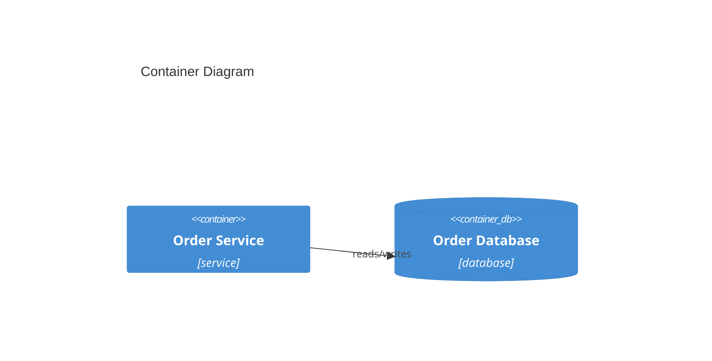

<!-- Default format for the Key Components diagram (C4 Level 2) — accept as-is or customize with architect during Step 0 (Confirm Artifact Formats). Generated from key-components-graph-format.md — never hand-authored independently of that data. Referenced from solution-overview.md > Key Components. Same explicit exception to DOCUMENTATION RULES' no-diagrams rule as system-context-diagram-format.md. -->

# Key Components — Diagram

