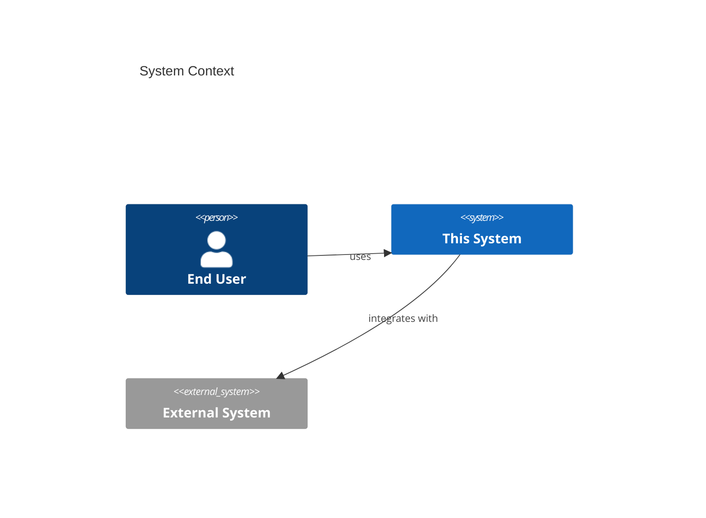

<!-- Default format for the System Context diagram (C4 Level 1) — accept as-is or customize with architect during Step 0 (Confirm Artifact Formats). Generated from system-context-graph-format.md — never hand-authored independently of that data. Referenced from solution-overview.md > System Context. This is the one artifact family with an explicit exception to DOCUMENTATION RULES' no-diagrams rule, since it's diagram-as-code generated from structured data, not a hand-drawn illustration. -->

# System Context — Diagram

